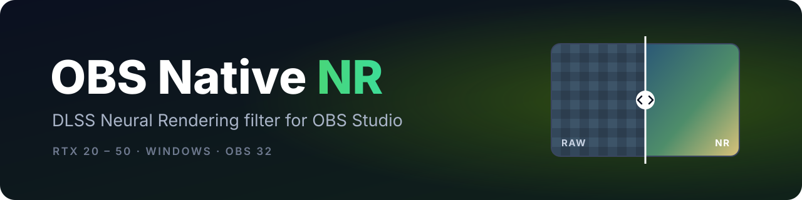

<div align="center">



<br />

**NVIDIA DLSS Neural Rendering, 2-Pass Combo, Anti-Flicker, DLSS 4.5 SR + CAS Upscaling, and NVIDIA VFG Preview for OBS Studio.**<br />
Put it on a capture card, game capture, window or media source. No ReShade, no injector, nothing added to the game.

<br />

[](https://github.com/grim-susemi/obs-nr-native-filter/releases/latest)
[](docs/INSTALL.md)
[](https://obsproject.com/)
[](LICENSE)

[Install](#install) · [Settings](#settings) · [Troubleshooting](#troubleshooting) · [Build](#build-from-source) · [한국어 요약](#한국어-요약)

</div>

> [!NOTE]
> Community project, not affiliated with NVIDIA or the OBS Project. NVIDIA runtime DLLs are **not redistributed** inside this repository or release zip. `install.bat` guides you through placing `nvngx_dlssnr.dll` and can automatically download & verify the official NVIDIA-signed DLSS 4.5 SR and NVIDIA VFG runtimes from NVIDIA's servers.

## What's new in 0.2.0

- **2-Pass NR Combo & Working Scale**: Run 1 or 2 NR passes with independent styles (e.g. Pass 1 Standard + Pass 2 Cinematic) and adjustable working resolution (50–100%).
- **Veyra-style Anti-Flicker & Refined Optical Flow**: Motion-compensated temporal stabilizer, static pixel hold (zero ghosting), and cost-gated 5-cell refined NVOF (`nr_guides`) to eliminate edge wobble.
- **DLSS 4.5 Super Resolution + AMD FidelityFX CAS**: Built-in 1080p→1440p/4K/DLAA upscaler with Preset K / M (DLSS 4.5) / L + linear-space CAS sharpening (falls back cleanly to bilinear+CAS if `nvngx_dlss.dll` is absent).
- **NVIDIA VFG Preview Window (2× / 3× / 4×)**: Right-click an OBS source/scene projector preview or open via filter/VFG controller for low-latency 120/180/240 fps frame generation (RTX 40/50) with NVIDIA Reflex markers and Pre/Post FPS HUD.
- **One-Click Official Runtime Setup**: `install.bat` optionally downloads and signature-verifies `nvngx_dlss.dll` (from NVIDIA/DLSS GitHub) and the 5 official NVIDIA VFG DLLs (from `pypi.nvidia.com`).

## Requirements

| | |
|---|---|
| OS | Windows 10 or 11, 64-bit |
| OBS Studio | 32.x, Direct3D 11 renderer (the default). Built and tested with 32.2.2 |
| GPU | NVIDIA RTX 20, 30, 40 or 50 series (NVIDIA VFG preview requires RTX 40/50) |
| NR model file | `nvngx_dlssnr.dll` 310.8.0.0 compatibility build, **not included** ([details](#the-nr-model-file)) |
| Optional runtimes | `nvngx_dlss.dll` (DLSS 4.5 SR) & NVIDIA VFG 1.3.0 DLLs — **auto-installed from official NVIDIA sources by `install.bat`** |

Tested on an RTX 4090 with driver 617.14 on Windows 11. Other RTX cards should work with the same NR model file.

### The NR model file

The NR filter accepts the 310.8.0.0 compatibility build of `nvngx_dlssnr.dll` (165,840,496 bytes, SHA-256 `e67dee209320cdafe0e93e45675d7aa34323a53acc57a72b2e40a181581c989a`), which supports RTX 20, 30, 40 and 50 cards.

**How to get it**

1. Join the RenoDX Discord: https://discord.gg/F6AUTeWJHM
2. Open this channel: https://discord.com/channels/1408098019194310818/1543975158937821315
3. Download the `nvngx_dlssnr.dll` **310.8.0.0 compatibility build** (165,840,496 bytes). Unzip it if needed.

## Install

1. Download `obs-nr-native-filter-0.2.1-windows-x64.zip` from the [latest release](https://github.com/grim-susemi/obs-nr-native-filter/releases/latest).
2. Close OBS completely (including tray icon).
3. Extract the entire zip and double-click **`install.bat`**.
4. Pick your language (`1` Korean, `2` English) and confirm the detected OBS folder.
5. Drag your `nvngx_dlssnr.dll` into the window (or press Enter to skip and add later).
6. Choose **Y** when prompted to automatically download and verify **DLSS 4.5 SR** (`nvngx_dlss.dll`, ~56 MB) and **NVIDIA VFG** (5 official signed DLLs, RTX 40/50), then approve the Windows Admin prompt.
7. Start OBS, right-click your source > **Filters** > **Effect Filters** > **+** > **Native NR**.

Step-by-step guide, manual install and uninstall: [docs/INSTALL.md](docs/INSTALL.md).

## Settings

| Group | Key Settings | Default | Notes |
|---|---|---|---|
| **Basic / Preset** | Quick preset, Composition strength, NR passes (1–2), Working scale (50–100%) | 1 pass, 100% | Use 75% working scale or 1 pass on 1440p/4K when running VFG simultaneously. |
| **1st / 2nd Pass** | Preset (0–3), Style (Standard/Natural/Cinematic), Intensity, Local structure, Local tone, Skin structure, Auto mask | Local tone **0** | Independent 2nd pass styles supported when passes = 2 and Custom 2nd pass is checked. |
| **Anti-flicker** | Temporal stability (0–1), Static stabilizer, Tolerance, Motion mode | 0.80, Static ON, Refined | Refined NVOF eliminates 4×4 block wobble; Static hold locks stationary UI/backgrounds with zero ghosting. |
| **DLSS 4.5 & CAS** | Output upscale (Off / 1440p / 4K / DLAA), DLSS SR model (K / M / L), CAS sharpening (0–1) | Off, Model M, CAS 0 | Automatically uses `bin/64bit/dlss/nvngx_dlss.dll`; falls back to bilinear+CAS if absent. |
| **FPS HUD / Status** | Pre/Post FPS overlay (Off / Top-Left / Top-Right), Status & Reason | Off | Shows live `IN -> NR FPS` on output. |

## Uninstall

Close OBS and run **`uninstall.bat`** from the extracted release folder. It removes plugin files, restores any backed-up files, and removes `nvngx_dlssnr.dll`, `dlss/nvngx_dlss.dll`, and `nvidia-vfg/*.dll` only if the installer copied them.

## Build from source

```powershell
cmake --preset windows-x64-release
cmake --build --preset windows-x64-release --parallel 4
ctest --preset windows-x64-release
.\packaging\windows\make-release.ps1 -BuildDir out\build\windows-x64-release
```

See [`deps/THIRD-PARTY-NOT-INCLUDED.md`](deps/THIRD-PARTY-NOT-INCLUDED.md) for the pinned NVIDIA NGX & Optical Flow SDK headers required to compile.

## Credits & License

- NR integration ported from [OptiScaler](https://github.com/optiscaler/OptiScaler) & [Dagherbou/OptiScaler_DLSSNR](https://github.com/Dagherbou/OptiScaler_DLSSNR).
- Anti-flicker, refined NVOF, DLSS SR, and NVIDIA VFG presenter architecture adapted from [Likely7/Veyra-NRVideo](https://github.com/Likely7/Veyra-NRVideo) (GPL-3.0-only).
- Colour composition derived from [RenoDX](https://github.com/clshortfuse/renodx) by clshortfuse ([MIT notice](provenance/source-notices/RenoDX-MIT.txt)).
- Contrast Adaptive Sharpening derived from AMD FidelityFX CAS (MIT).

Source code is licensed under [GNU GPL v3](LICENSE) (GPL-3.0-only).

Related: [OptiScaler-Susemi](https://github.com/grim-susemi/OptiScaler-Susemi) · [DLSS5 NR guide](https://github.com/grim-susemi/dlss5-nr-guide)

---

## 한국어 요약

OBS 소스에 NVIDIA DLSS NR(뉴럴 렌더링), 2패스 조합, Veyra 방식 안티플리커, DLSS 4.5 업스케일(1440p/4K/DLAA) + CAS 선명도, 그리고 RTX 40/50용 NVIDIA VFG(2배~4배 미리보기 프레임 생성)를 한 번에 제공하는 OBS 플러그인입니다.

**설치 방법 (원클릭)**

1. [최신 릴리즈](https://github.com/grim-susemi/obs-nr-native-filter/releases/latest)에서 `obs-nr-native-filter-0.2.1-windows-x64.zip`을 내려받아 압축을 풉니다.
2. OBS를 완전히 끕니다.
3. **`install.bat`** 을 더블클릭하고 Enter(한국어) → OBS 폴더 확인을 누릅니다.
4. `nvngx_dlssnr.dll`(310.8.0.0 호환판, SHA-256 `e67dee20…c989a`)이 OBS에 없으면 창에 끌어다 놓고 Enter를 누릅니다. (RenoDX 디스코드: https://discord.gg/F6AUTeWJHM)
5. **DLSS 4.5 SR(`nvngx_dlss.dll`)** 과 **NVIDIA VFG(5개 DLL)** 자동 다운로드 안내가 나오면 Enter(Y)를 누르세요. 설치기가 NVIDIA 공식 서버에서 직접 받아 서명·SHA-256 검증까지 끝내고 OBS에 배치합니다.
6. 관리자 권한 창에서 **예**를 누르면 설치가 끝납니다.
7. OBS를 켜고 소스 우클릭 > **필터** > **효과 필터 [+]** > **Native NR** 을 추가합니다. (기존 `rtx-superresolution` 구형 필터는 끄고 사용하세요.)

자세한 안내와 제거(`uninstall.bat`)·문제 해결은 [설치 안내서](docs/INSTALL.md#한국어-설치-안내)를 참고하세요.
