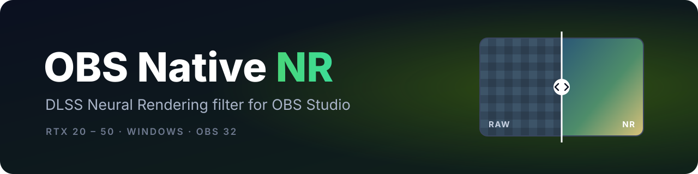

<div align="center">



<br />

**NVIDIA DLSS Neural Rendering as an OBS Studio filter.**<br />
Put it on a capture card, game capture, window or media source. No ReShade, no injector, nothing added to the game.

<br />

[](https://github.com/grim-susemi/obs-nr-native-filter/releases/latest)
[](docs/INSTALL.md)
[](https://obsproject.com/)
[](LICENSE)

[Install](#install) · [Settings](#settings) · [Troubleshooting](#troubleshooting) · [Build](#build-from-source) · [한국어 요약](#한국어-요약)

</div>

> [!NOTE]
> Community project, not affiliated with NVIDIA or the OBS Project. The NVIDIA NR model file (`nvngx_dlssnr.dll`) is **not included** and not hosted here. You supply it yourself, see [The NR model file](#the-nr-model-file).

## What it does

- Adds a **Native NR** filter to OBS. Put it on a source and the picture goes through NVIDIA's DLSS Neural Rendering model before it reaches your preview, stream and recording.
- Runs inside OBS as an ordinary plugin. The game, console or app you capture is not touched.
- Works on any video source, so console footage through a capture card works too.
- If a frame is not ready in time, the previous processed frame is shown (up to 2 in a row) instead of flashing back to the original, so 60 fps output does not flicker.
- NVIDIA's NR controls are filter properties: model preset, style, intensity, local structure, local tone, skin structure and automatic mask.

## Requirements

| | |
|---|---|
| OS | Windows 10 or 11, 64-bit |
| OBS Studio | 32.x, Direct3D 11 renderer (the default). Built and tested with 32.2.2 |
| GPU | NVIDIA RTX 20, 30, 40 or 50 series |
| NR model file | `nvngx_dlssnr.dll` 310.8.0.0 compatibility build, **not included** ([details](#the-nr-model-file)) |

Tested on an RTX 4090 with driver 617.14 on Windows 11. Other RTX cards should work with the same model file but have not been tested yet. Reports are welcome in [Issues](https://github.com/grim-susemi/obs-nr-native-filter/issues).

### The NR model file

The filter accepts exactly one build of `nvngx_dlssnr.dll`: the 310.8.0.0 compatibility build that circulates in the RenoDX community (ShortFuse's DLSS thread on the RenoDX Discord). It contains GPU code for RTX 20, 30, 40 and 50 cards.

| | |
|---|---|
| SHA-256 | `e67dee209320cdafe0e93e45675d7aa34323a53acc57a72b2e40a181581c989a` |
| Size | 165,840,496 bytes |

NVIDIA's own signed builds (310.8.0.0 `e16bcf15...` and 310.9.16.0) only contain RTX 50 code and are refused by this version. The installer checks the hash for you. To check a file yourself:

```powershell
(Get-FileHash 'C:\path\to\nvngx_dlssnr.dll' -Algorithm SHA256).Hash   # must start with E67DEE209320
```

## Install

1. Download `obs-nr-native-filter-0.1.0-windows-x64.zip` from the [latest release](https://github.com/grim-susemi/obs-nr-native-filter/releases/latest).
2. Close OBS completely.
3. Extract the whole zip and double-click **`install.bat`**. Pick a language, confirm your OBS folder and choose **Yes** at the admin prompt.
4. When it asks for the NR model file, drag your `nvngx_dlssnr.dll` into the window and press Enter. Skip this if it is already in `obs-studio\bin\64bit`.
5. Start OBS, right-click your source > **Filters** > **Effect Filters** > **+** > **Native NR**.

The filter properties show **Status: NR is being applied** when it works. Step-by-step guide, manual install and uninstall: [docs/INSTALL.md](docs/INSTALL.md).

## Settings

| Setting | Range | Default | What it does |
|---|---|---|---|
| Enable native NR | on / off | on | Turns NR on for this source. |
| NR runtime file | path | `C:/Program Files/obs-studio/bin/64bit/nvngx_dlssnr.dll` | Where the model file is. Change it only if OBS lives elsewhere, then remove and re-add the filter. |
| Composition strength | 0 to 1 | 1 | 0 shows the original, 1 the full NR result. |
| NR model preset | 0 to 3 | 0 | NVIDIA's model preset. |
| NR style | Standard / Natural / Cinematic | Standard | NVIDIA's look presets. |
| NR intensity | 0 to 2 | 1 | How strongly the model changes the picture. |
| Local structure | 0 to 2 | 1 | Fine detail and texture. |
| Local tone | 0 to 2 | **0** | Local brightness and contrast. NVIDIA's default is 1, which lifts shadows and adds a slight green tint, so this filter starts at 0 and keeps your source's brightness. |
| Skin structure | -1 to 2 | -1 | Detail on skin. -1 follows Local structure. |
| Automatic mask | on / off | on | NVIDIA's automatic mask. |

Changing a value restarts NR for that filter, so the original can show for a moment. The status and reason lines in the filter properties tell you what the filter is doing.

## Troubleshooting

| What you see | What to do |
|---|---|
| **Native NR** is not in the filter list | The plugin is not in this OBS. Run `install.bat` again and check the OBS folder it shows. OBS must be 32.x, 64-bit. |
| Reason: the NR runtime file does not exist | Put `nvngx_dlssnr.dll` in `obs-studio\bin\64bit`, or set **NR runtime file** to its full path, then remove and re-add the filter. |
| Reason: ... (hash differs) | Wrong build of the model file. See [The NR model file](#the-nr-model-file). |
| Reason: D3D11 renderer required | OBS Settings > Advanced > Video > Renderer: Direct3D 11, then restart OBS. |
| Reason: the graphics driver reset the GPU | Restart OBS. If it keeps happening, lower the source resolution or frame rate. |
| Picture looks brighter or greenish | Set **Local tone** to 0. |

The OBS log (Help > Log Files > View Current Log) has lines starting with `[obs-nr-filter]`. A line with `native=1 failed=0` means NR started. Please include those lines when you report a problem.

## Performance

NR is heavy. In tests on an RTX 4090 with a 2528×1369 source at 60 fps, NR was applied to about 99% of frames; the rest reused the previous NR frame. Lower resolution or frame rate leaves more headroom.

## Known limitations

- Only tested on an RTX 4090.
- The default model path assumes OBS in `C:\Program Files\obs-studio`. For Steam, portable or other folders, set **NR runtime file**; the installer prints the path to use.
- SDR sources only. HDR colour spaces are refused and the original passes through.
- If the graphics driver resets the GPU, NR stays off until OBS restarts.

## Uninstall

Close OBS and run **`uninstall.bat`** from the release folder. It removes the plugin files, puts back anything the installer replaced, and removes `nvngx_dlssnr.dll` only if the installer copied it.

## Build from source

The build is currently set up for one machine layout:

- Visual Studio 2022 Build Tools with MSVC 14.44.35207 (path set in [`cmake/nr/Libobs.cmake`](cmake/nr/Libobs.cmake)) and CMake 3.28 or newer.
- OBS Studio 32.2.2 installed in `C:\Program Files\obs-studio`. The build imports its `obs.dll` and checks the hash; OBS 32.2.2 headers are included in `deps/obs-headers`.
- NVIDIA NGX SDK headers (API 1.5.0) and Optical Flow SDK 5.0.7 headers, which are not included. Paths and hashes: [`deps/THIRD-PARTY-NOT-INCLUDED.md`](deps/THIRD-PARTY-NOT-INCLUDED.md).

```powershell
cmake --preset windows-x64-release
cmake --build --preset windows-x64-release --parallel 4
ctest --preset windows-x64-release            # GPU tests need an RTX card and the model file
.\packaging\windows\make-release.ps1 -BuildDir out\build\windows-x64-release
```

## How it works

1. OBS renders the source. The filter hands the frame to its own Direct3D 12 device.
2. NVIDIA Optical Flow measures motion between frames.
3. The NR model processes the frame with that motion information.
4. A colour step derived from RenoDX keeps the source's colour range and alpha.
5. The result goes back into OBS. A late frame reuses the previous NR result (up to 2), otherwise the original is shown.

## Credits

- NR integration ported from the OptiScaler DLSS NR work: [OptiScaler](https://github.com/optiscaler/OptiScaler), [Dagherbou/OptiScaler_DLSSNR](https://github.com/Dagherbou/OptiScaler_DLSSNR) and the contributors in [CREDITS](provenance/source-notices/CREDITS.md).
- Colour composition derived from [RenoDX](https://github.com/clshortfuse/renodx) by clshortfuse ([MIT notice](provenance/source-notices/RenoDX-MIT.txt)).
- RTX 20 to 50 compatible model build by ShortFuse (RenoDX community).
- Project layout from [obs-plugintemplate](https://github.com/obsproject/obs-plugintemplate).
- NVIDIA DLSS, NGX and Optical Flow belong to NVIDIA and are not included.

Related: [OptiScaler-Susemi](https://github.com/grim-susemi/OptiScaler-Susemi) · [DLSS5 NR guide](https://github.com/grim-susemi/dlss5-nr-guide)

## License

Source code is licensed under the [GNU GPL v3](LICENSE) (GPL-3.0-only). Parts derived from RenoDX are MIT-licensed. NVIDIA SDK files and the NR model file are not part of this repository and stay under NVIDIA's terms.

---

## 한국어 요약

OBS 소스에 NVIDIA DLSS NR(뉴럴 렌더링)을 바로 거는 OBS 필터입니다. 캡처보드로 받은 콘솔 화면, 게임 캡처, 창 캡처 어디에나 쓸 수 있고 ReShade나 주입 DLL이 필요 없습니다. 60fps에서 한 프레임이 늦어도 원본으로 깜빡이지 않고 직전 NR 화면을 유지합니다.

**준비물**

- Windows 10/11 64비트, OBS Studio 32.x (32.2.2에서 시험)
- NVIDIA RTX 20~50 시리즈 (RTX 4090에서 시험)
- `nvngx_dlssnr.dll` 310.8.0.0 호환판, SHA-256 `e67dee20…c989a`. **이 저장소와 릴리즈에는 들어 있지 않습니다.** RenoDX 커뮤니티(ShortFuse DLSS 스레드)에서 구하세요. NVIDIA 정품 310.8 / 310.9.16은 RTX 50 전용이라 받지 않습니다.

**설치**

1. [최신 릴리즈](https://github.com/grim-susemi/obs-nr-native-filter/releases/latest)에서 `obs-nr-native-filter-0.1.0-windows-x64.zip`을 받습니다.
2. OBS를 완전히 끕니다.
3. 압축을 전부 풀고 **`install.bat`** 을 더블클릭 → 한국어 선택 → OBS 폴더 확인 → 관리자 권한 창에서 **예**.
4. NR 모델 파일을 물어보면 가지고 있는 `nvngx_dlssnr.dll`을 창에 끌어다 놓고 Enter.
5. OBS를 켜고 소스 우클릭 > **필터** > **효과 필터**의 **+** > **Native NR**.

필터 속성에 **상태: NR 적용 중**이 보이면 성공입니다. 화면이 밝아지거나 초록빛이 돌면 **로컬 톤**이 0인지 확인하세요(기본값 0). 자세한 안내와 문제 해결은 [설치 안내서](docs/INSTALL.md#한국어-설치-안내)에 있고, 제거는 같은 폴더의 `uninstall.bat`입니다.
