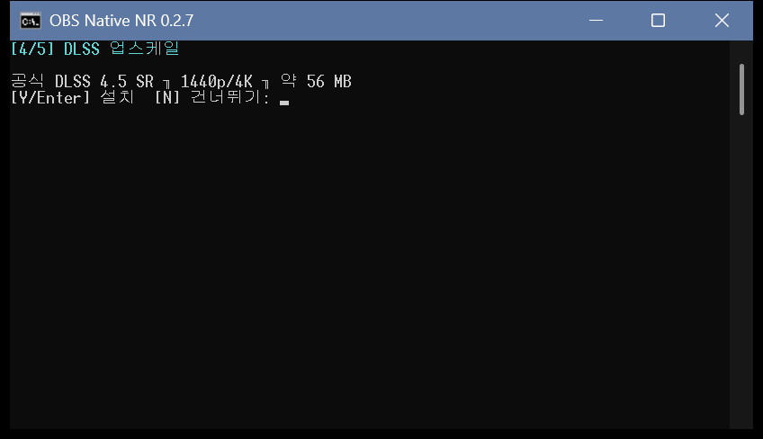
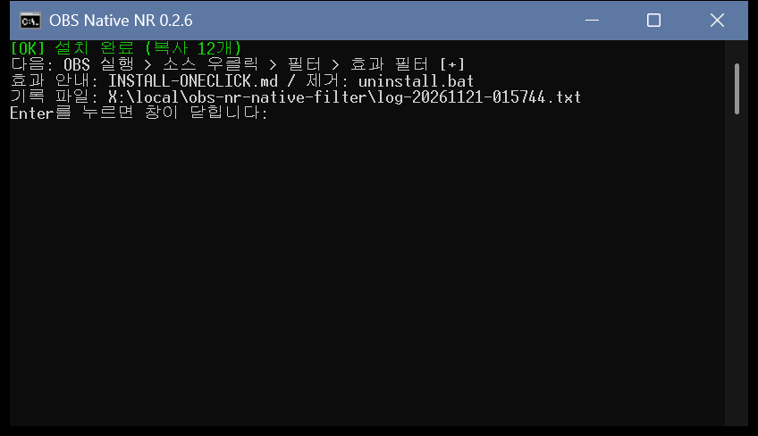
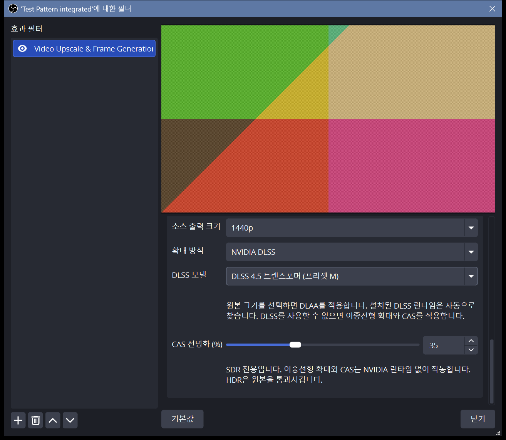

# OBS 원클릭 설치 — 0.3.0

1. `SHA256SUMS.txt`로 ZIP을 확인하고 **모두 압축 해제**합니다. OBS를 종료한 뒤 `install.bat`을 더블클릭합니다. 포터블 OBS가 목록에 없으면 `bin\64bit\obs64.exe`가 들어 있는 OBS 최상위 폴더를 지정합니다.
2. 설치기는 현재 질문만 표시합니다. 이 ZIP에는 Native NR용 `nvngx_dlssnr.dll` **310.9.16.0 Model B** (`cdfa6c1e…bf3ed`)가 `files\bin\64bit`에 동봉되어 있어, 별도 질문·수동 입력·로컬 Veyra 탐색 없이 SHA-256 검증 후 OBS `bin\64bit`에 바로 설치됩니다. **310.8.0.0** (`e67dee20…c989a`)도 계속 허용됩니다. 경량 패키지(미동봉)라면 OBS에 파일이 없을 때 로컬 Veyra(`%LOCALAPPDATA%\Programs\Veyra (NVIDIA)\versions\*\runtime\experimental\nr-ampere\nvngx_dlssnr.dll`)의 검증된 `310.9.16.0` 파일을 자동 재사용하고, 아니면 모델 질문에서 직접 지정하거나 `-Runtime <경로>`를 전달하거나 Enter로 건너뜁니다. DLSS와 VFG는 각각 **Y 또는 Enter**로 설치하고 **N**으로 건너뜁니다. 자세한 준비 사항은 [설치 안내](INSTALL.md)를 참고하세요.

3. OBS에서 **소스 우클릭 → 필터 → 효과 필터의 + → 영상 업스케일 및 프레임 생성**을 선택합니다. 업스케일만 쓰려면 오른쪽 속성에서 아래로 스크롤해 **업스케일 및 선명화**를 켭니다. VFG 창은 **미리보기 창 제어 · 상태**에서 엽니다(VFG는 저지연 쌍 프레임 생성을 위해 **`batchCapacity=2`**로 동작하며, 120fps 구성 시 OBS 설정 > 비디오 > FPS를 **`120/1`**로 맞춥니다). 노이즈 제거용 **Native NR**은 같은 `+` 메뉴에서 별도로 추가한 뒤 **빠른 프리셋**에서 **`Veyra 추천`**을 선택할 수 있으며, `310.9.16.0` 사용 시 **Model B** 성능 모델을 켤 수 있습니다.

4. 효과가 실행 중인 OBS의 설치 폴더에서 런타임을 자동으로 찾습니다. 효과 설정에는 런타임 경로 입력이나 찾아보기 버튼이 없습니다. 이전 장면에 저장된 유효 경로는 유지하고, 파일이 사라졌으면 현재 설치 폴더를 확인합니다. 검증에 실패한 파일은 사용하지 않습니다.

효과가 안 보이면 설치 완료 화면에 나온 기록 파일에서 선택한 OBS 폴더를 확인하고 OBS를 다시 시작하세요. DLSS 런타임을 사용할 수 없으면 이중선형/CAS로 계속 쓸 수 있습니다. Native NR이 우회되거나 VFG 창이 안 열리면 [설치 안내](INSTALL.md)의 해당 런타임과 OBS 로그를 확인하세요. 기존 장면에 저장된 독립 업스케일은 계속 작동하지만 새 효과 목록에는 없습니다. 제거는 OBS를 닫고 `uninstall.bat`을 실행합니다.

콘솔 화면은 격리 원클릭 설치에서, 업스케일 설정 예시는 격리 OBS에서 캡처했습니다.
